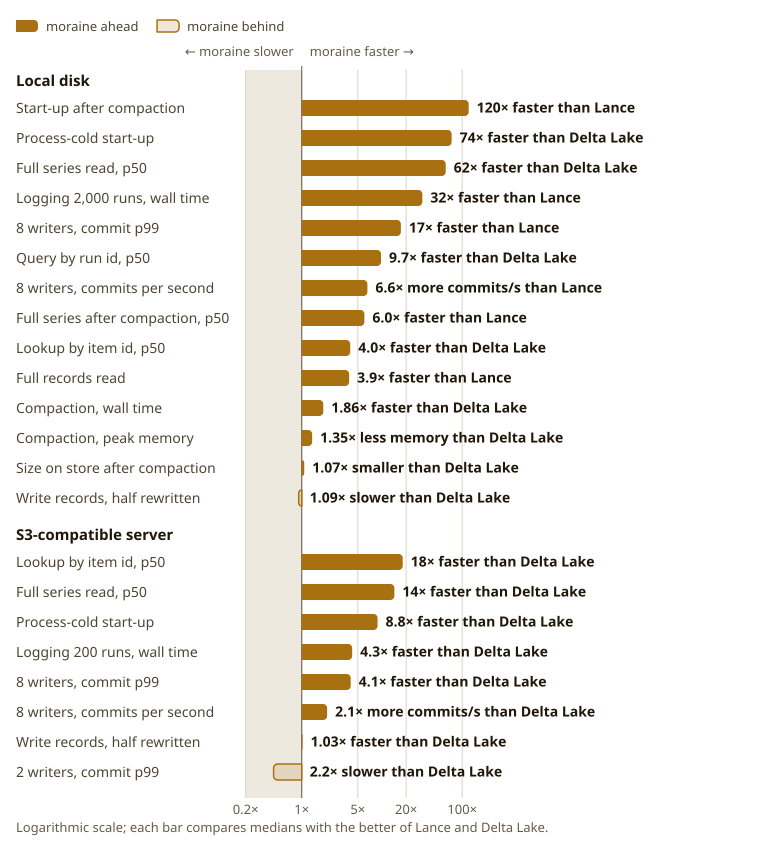

<p align="center">
  <picture>
    <source media="(prefers-color-scheme: dark)" srcset="assets/banner-dark.svg">
    
  </picture>
</p>

<p align="center">
  <a href="https://crates.io/crates/morainedb"></a>
  <a href="https://docs.rs/morainedb"></a>
  <a href="https://github.com/sayef/moraine/actions/workflows/ci.yml"></a>
</p>

**moraine is a Rust library for many processes writing and reading the same tables on S3 or local
disk, with no server: a commit is one conditional PUT of the next Delta Lake log entry.**
moraine is pre-1.0; the API may still change.

[Documentation](https://morainedb.pages.dev) |
[Getting started](https://morainedb.pages.dev/getting-started/) |
[API reference](https://docs.rs/morainedb) |
[Benchmarks](https://morainedb.pages.dev/benchmarks/) |
[Design decisions](DECISIONS.md)

## Why moraine exists

I wanted tables that several machines can write at once, in a bucket, without running anything
next to the bucket: no database server, no lock table, no coordinator. Delta Lake almost gives
that. Its log is a sequence of numbered objects, and S3 now has the put-if-absent that makes
"whoever writes version 42 first wins" safe. But a commit through delta-rs costs several round
trips (a log listing, the commit, post-commit work, checkpoint listings), and under contention a
writer that loses a race pays for all of them again. On my tracker workloads a Delta Lake engine
was 70 to 86 % slower than Lance at logging.

moraine keeps the Delta Lake format and writes the log entries itself, with a request budget:
an append costs one PUT per data file plus one conditional PUT of the log entry, and nothing
else. A writer that loses a race reads the winning entry with one GET and puts again at the next
version. Everything else (sorting, pruning, caches, indexes) is there to keep reads as cheap as
those commits.

## What it does

- **Standard Delta Lake tables** (reader version 1, writer version 2, no table features). The
  interoperability tests read moraine's tables with delta-rs and open tables delta-rs wrote.
- **Many writers, no server.** Group commit per table handle, conflict-checked rebase after a lost
  race, a starvation guard, a commit deadline, and a capability probe that refuses to write to a
  store that ignores conditional writes.
- **No double commits.** An ambiguous response is resolved through the handle's own transaction
  id before any retry.
- **Exactly-once writes.** `table.txn(app_id, version)` tags a write; a replay is reported as
  already applied, across retries, processes and restarts.
- **Append, upsert, delete, update, added columns,** and point lookups by primary key.
- **Reads that touch few bytes.** Files are sorted by cluster key and primary key; reads skip
  files by key range, bloom filter and key index, and pages by the Parquet page index. Footers,
  key indexes and small tables are cached per version.
- **Sidecar indexes.** One immutable bundle per data file and index: a key index, vector search
  with usearch or TurboQuant (turbovec), and full-text search with tantivy. A file without its
  sidecar is answered by an exact route, so results never depend on the index being built.
  Writers and compaction build a new file's sidecars before the commit that adds it.
- **Blobs.** Binary values of any size in a column: small ones inside the row, large ones as
  objects beside the table, with ranged and streamed reads, server-side copies of reused
  references, and collection by vacuum.
- **Full-text ranking of one index.** BM25 statistics are summed over every file before scoring,
  so per-file indexes rank exactly as one tantivy index over the whole table would. Hybrid search
  fuses a vector and a full-text ranking with reciprocal rank fusion.
- **Four consistency levels:** strong (one small GET per query), eventual (default, 5 s),
  background (a task per handle refreshes and prewarms the caches, so queries make no snapshot
  request) and manual.
- **A deterministic simulation test kit:** a fault-injecting store, a simulated clock, a seeded
  scheduler, a reference model and an invariant checker. Upserts, deletes and updates passed
  100,000 seeds of each of their four scenarios.

## Benchmarks

How many times faster moraine is than the better of Lance and Delta Lake, median against median,
on local disk and an S3-compatible server; outlined bars left of 1× are losses.

<!-- chart:headline -->

<picture>
  <source media="(prefers-color-scheme: dark)" srcset="docs/assets/charts/headline-dark.svg">
  
</picture>

<!-- /chart:headline -->

Lance and Delta Lake run through [kv0](https://github.com/sayef/kv0), a tracker with a write-ahead
log that moraine's adapter does not have, so the logging ratios are an upper bound on the engine
difference. Per-workload charts, exact numbers and the method:
[benchmarks](https://morainedb.pages.dev/benchmarks/).

## Quick start

moraine is on crates.io as a beta. The crate is `morainedb` and the library is `moraine`; use
the same `arrow` version (59.3.2). The API reference is on [docs.rs](https://docs.rs/morainedb).

```sh
cargo add morainedb@0.1.0-beta.2
```

```toml
[dependencies]
morainedb = "0.1.0-beta.2"
arrow = "=59.3.2"
tokio = { version = "1", features = ["macros", "rt-multi-thread"] }
```

```rust
use std::sync::Arc;

use arrow::array::{Float64Array, RecordBatch, StringArray};
use arrow::datatypes::{DataType, Field, Schema};
use moraine::expr::{col, lit};
use moraine::{Database, TableOptions};

#[tokio::main]
async fn main() -> moraine::Result<()> {
    // A local directory here; "s3://bucket/prefix" in production.
    let db = Database::builder("moraine-data").open().await?;
    let schema = Arc::new(Schema::new(vec![
        Field::new("device", DataType::Utf8, false),
        Field::new("celsius", DataType::Float64, false),
    ]));
    let options = TableOptions::default().cluster_by(["device"]);
    let table = db.create_table("readings", schema.clone(), options).await?;

    let batch = RecordBatch::try_new(
        schema,
        vec![
            Arc::new(StringArray::from(vec!["boiler", "attic"])),
            Arc::new(Float64Array::from(vec![61.5, 14.0])),
        ],
    )
    .expect("columns match the schema");

    // Exactly once: a second send of (app id, version) is reported, not written.
    let outcome = table.txn("ingest-1", 1).append(vec![batch]).await?;
    if outcome.is_committed() {
        println!("committed at version {}", outcome.version());
    } else {
        println!("already in version {}", outcome.version());
    }

    let boiler = table.scan().filter(col("device").eq(lit("boiler"))).collect().await?;
    println!("{} row(s)", boiler.iter().map(|b| b.num_rows()).sum::<usize>());
    Ok(())
}
```

No Cargo feature is on by default: tables, scans, point lookups, blobs and maintenance need
none. The index kinds are opt-in, since each pulls in a large library: `vector` (usearch HNSW),
`turbovec` (TurboQuant), `fts` (tantivy full-text and hybrid search); `aws-sdk` adds the AWS SDK's
credential chain.

The [getting started guide](https://morainedb.pages.dev/getting-started/) adds upserts, point
lookups, S3 and a vector search. Vector search needs the `vector` feature:

```rust
let spec = IndexSpec::new("emb", "vec-hnsw", &["embedding"])   // a List<Float32> column
    .params(json!({"dim": 384, "metric": "cosine"}));
table.create_index(spec).await?;
table.build_indexes(BuildOptions::default()).await?;            // any client, any time

let nearest = table
    .search_vector("emb", query)
    .limit(10)
    .filter(col("lang").eq(lit("en")))
    .select(["id"])
    .collect()
    .await?;
```

## Maintenance

A long-lived table needs maintenance passes (`Table::maintain`, `spawn_maintenance` or the
`moraine` command) to stay compact: without them nothing compacts, checkpoints or vacuums it,
and it grows in files and log entries. Maintenance is never needed for correctness.

## Repository

| Path | Contents |
|---|---|
| `crates/moraine` | The library (package `morainedb`, imported as `moraine`) |
| `crates/moraine-testkit` | Chaos store, simulated clock and store, scheduler, reference model, invariant checker; the integration tests |
| `crates/moraine-cli` | The `moraine` command: inspect, maintain, verify, repair, pins; and the T8 stress test |
| `bench/` | The comparison against Lance and Delta Lake; a workspace of its own |
| `spike/` | The spike: how I validated the approach before writing the library |
| `docs/` | The documentation site, the spike results and the benchmark log |

- [`DECISIONS.md`](DECISIONS.md): every design decision, with the reason.
- [`CONTRIBUTING.md`](CONTRIBUTING.md): building, testing and the simulation.
- [`SECURITY.md`](SECURITY.md): reporting a vulnerability.

## Licence

Licensed under either of [Apache License, Version 2.0](LICENSE-APACHE) or [MIT](LICENSE-MIT), at
your option.
