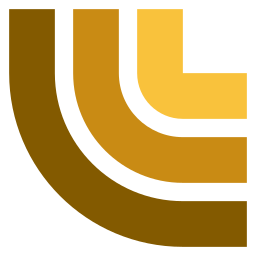
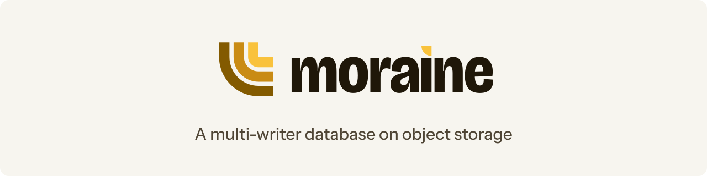
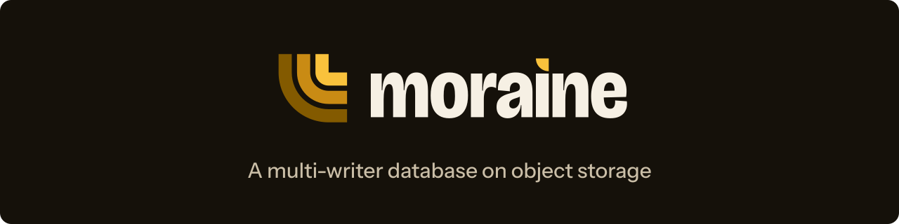

# Brand

A moraine is the ridge of rock a glacier carries and leaves behind, laid down layer by layer and
never rewritten in place. Many glaciers can feed one ridge. A moraine table works the same way:
any number of writers commit side by side, with no server between them, and each commit becomes
the next entry in one ordered log. The identity is drawn from that one idea: **writers come in side
by side and leave as ordered beds, and the newest bed is ochre**.

The full token sheet is [`brand/DESIGN.md`](https://github.com/sayef/moraine/blob/main/brand/DESIGN.md);
every asset and the site's colour tokens are generated by
[`assets/src/build.py`](https://github.com/sayef/moraine/blob/main/assets/src/build.py).

## The mark

{ width="96" height="96" }
{ width="311" height="78" .mr-logo--light }
{ width="311" height="78" .mr-logo--dark }

Three bands come down side by side, parallel like concurrent writers, and each turns a quarter
circle into a horizontal bed, stacked like entries in the log. The bands share one centre, so the
outermost stream becomes the oldest bed at the bottom and the innermost becomes the newest on top.
The beds darken with age; the newest is always ochre.

On a 256-unit grid the bands have a 40-unit stroke, 16-unit gaps and 56-unit straight legs, with
their ends cut flush to the margin, so the mark is a square. At 16 and 32 pixels a second drawing
sits on the pixel grid: 2-pixel bands, 1-pixel gaps and legs 6 pixels long. The legs matter. Without
them the turn is only concentric arcs, and concentric arcs read as a wifi symbol.

The wordmark is `moraine` in Bricolage Grotesque at weight 780 and a slightly condensed width,
converted to outlines. Its i is dotted with one turned bed from the mark, in ochre.

Do not recolour or reorder the beds, add a gradient or an outline, round the flush ends, or rotate
the mark: the streams always come down from the top and turn to the right.

## Colour

Ochre is the yellow iron oxide that stains glacial till; it is the only accent. Umber is the
ground by night and parchment by day. The accent is ochre-700 on the light ground and ochre-300 on
the dark one, and it is reserved for links, the current place and the primary action.

<ul class="mr-swatches">
  <li><b>Parchment</b> ground, light <code>#F7F5EF</code></li>
  <li><b>Umber ink</b> text, light <code>#1F1709</code></li>
  <li><b>Ochre 700</b> accent, light; oldest bed <code>#835A00</code></li>
  <li><b>Umber</b> ground, dark <code>#15110A</code></li>
  <li><b>Parchment ink</b> text, dark <code>#F6F0E4</code></li>
  <li><b>Ochre 300</b> accent, dark; newest bed <code>#F9C23C</code></li>
  <li><b>Ochre 500</b> middle bed <code>#C98B14</code></li>
</ul>

The mark's beds are the same three ramp stops on either ground: 700 for the oldest, 500 for the
middle and 300 for the newest. Every text colour meets WCAG AA on the surfaces it is used on, and
the build script that writes the site's tokens stops if one does not: body text is 16:1 in both
themes, the accent 5.6:1 on the light ground and 11.5:1 on the dark one. Structure comes from tone
steps between surfaces, not from shadows or rules.

## Type

**Bricolage Grotesque** sets the wordmark and the headings: heavy, slightly condensed, with ink
traps that keep it crisp at large sizes. **Instrument Sans** carries the text, navigation and
tables. **Spline Sans Mono** is for code and identifiers only. All three are under the SIL Open
Font License and served from this site; nothing loads from a font service.

Five sizes, far apart: the display line on the home page, page titles, section headings, body
text and small print. Headings stay at two lines or fewer at every width.

## The turn

The turn appears in four places and nowhere else: the mark, the wordmark's i, the edge under this
site's header, where the three beds turn down out of the header and run under it, and the commit
diagram on the home page, where the two writers' entries come down as streams and turn into beds.

{ width="640" height="160" .mr-logo--light }
{ width="640" height="160" .mr-logo--dark }

## Files

| File | Use |
|---|---|
| `logo.svg`, `logo-dark.svg` | The mark; the same drawing works on light and dark grounds |
| `wordmark.svg`, `wordmark-dark.svg` | The mark with the name |
| `favicon.svg` | The small drawing, on the 16 px pixel grid |
| `banner-light.svg`, `banner-dark.svg` | The README banner, 1280 by 320, each on its own ground |
| `social-preview.png` | 1280 by 640, for the repository's social preview and link cards |
| `apple-touch-icon.png` | 180 by 180, on umber |

All of them are in [`assets/`](https://github.com/sayef/moraine/tree/main/assets) and are
licensed with the code.
