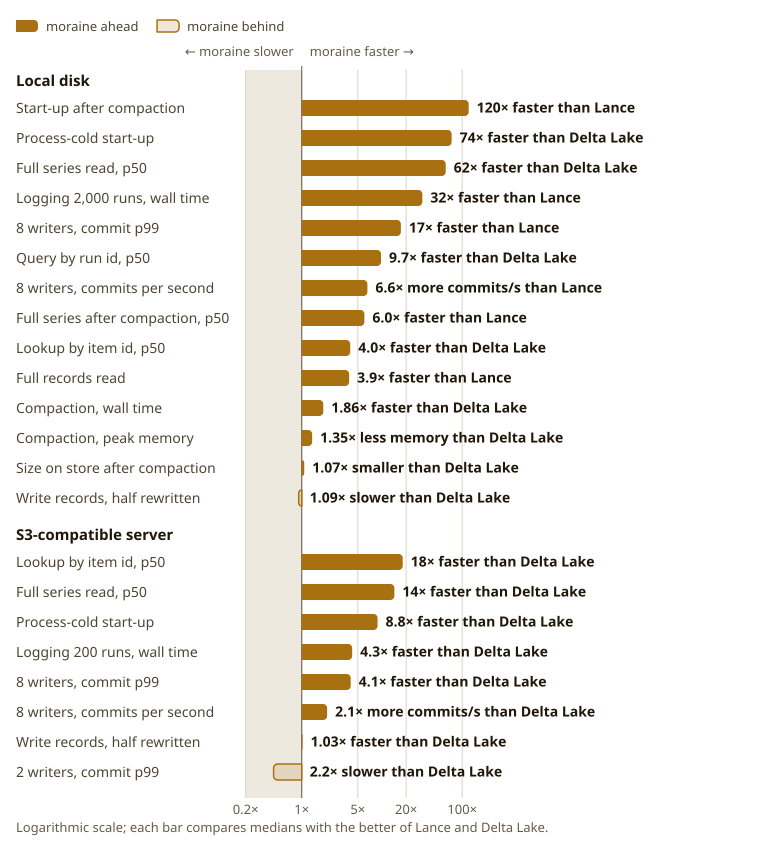
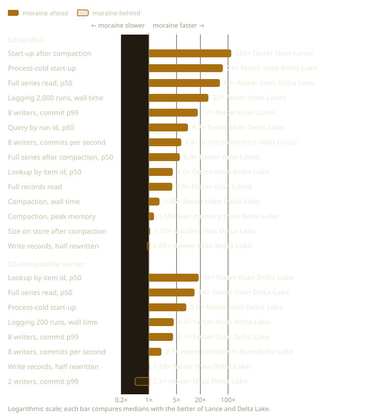

<div class="mr-hero" markdown>

<div class="mr-hero__text" markdown>

# Many writers, one bucket { .mr-display }

moraine is a Rust library for many processes writing the same tables on S3 or local disk. There
is no server and no lock: a commit is one conditional PUT of the next Delta Lake log entry.
{ .mr-lede }

[Start with the tutorial](getting-started.md){ .md-button .md-button--primary }
[Read the benchmarks](benchmarks.md){ .md-button }

moraine is pre-1.0; the API may still change.
{ .mr-small .mr-muted }

</div>

<div class="mr-hero__code" markdown>

```rust
let db = Database::builder("s3://bucket/db")
    .open()
    .await?;
let opts = TableOptions::default();
let table = db
    .create_table("readings", schema, opts)
    .await?;

// One PUT for the data file, one
// conditional PUT for the log entry.
table.append(vec![batch]).await?;

let boiler = table
    .scan()
    .filter(
        col("device").eq(lit("boiler")),
    )
    .collect()
    .await?;
```

</div>

</div>

## How a commit lands { #how-a-commit-lands }

<div class="mr-commit" markdown>

<figure class="mr-log" aria-labelledby="mr-log-caption">
  <ol class="mr-log__layers" reversed start="43">
    <li class="mr-log__layer mr-log__layer--new"><code>00000000000000000043.json</code><span>Writer B, after reading 42: the same entry, one version up</span></li>
    <li class="mr-log__layer mr-log__layer--won"><code>00000000000000000042.json</code><span>Writer A: the put-if-absent landed</span></li>
    <li class="mr-log__layer"><code>00000000000000000041.json</code><span>An earlier commit</span></li>
    <li class="mr-log__layer mr-log__layer--old"><code>00000000000000000040.json</code></li>
    <li class="mr-log__layer mr-log__layer--older"><code>00000000000000000039.json</code></li>
  </ol>
  <figcaption id="mr-log-caption">A table's <code>_delta_log/</code>, newest entry on top. Each entry is one object, written once and never changed.</figcaption>
</figure>

<div class="mr-steps" markdown>

1. **Queue.** Writes from any number of tasks in one process join the table handle's queue. The
   first to find no commit in flight leads and takes everything compatible with it.
2. **Upload.** The leader writes the rows as Parquet files sorted by cluster key and primary key,
   one PUT each. Nothing refers to them yet, so no reader can see them.
3. **Commit.** One PUT of the next entry, `_delta_log/<version>.json`, with `If-None-Match: *`.
   When it lands, every caller in the group gets that version.
4. **Lose a race.** When another writer took the version first, the leader reads that entry with
   one GET, checks it for conflicts and puts its entry at the next version. No listing, no lock.
5. **Lose the response.** When a put's outcome is unknown, the handle looks for its own transaction
   id in the log before it tries again, so a commit never lands twice.

[The commit protocol in detail](concepts/commits.md)

</div>

</div>

## What a table gives you

<div class="mr-facts" markdown>

Standard Delta Lake tables
:   Parquet data files and a Delta log at reader version 1 and writer version 2, with no table
    features. The interoperability tests read moraine's tables with delta-rs and open tables
    delta-rs wrote. [The Delta log](concepts/delta-log.md)

Exactly-once writes
:   Tag a write with an application id and version; a retry, a crashed process or a second replica
    replaying it gets "already applied". [Exactly-once writes](concepts/exactly-once.md)

Reads that touch few bytes
:   Files are sorted by cluster key and primary key; reads skip files by key range, bloom filter
    and key-index sidecar, and pages by the Parquet page index. Footers and small tables stay in
    memory per version. [Clustering and pruning](concepts/clustering.md)

Indexes beside the data
:   One immutable sidecar per data file: a key index, vector search with usearch or TurboQuant,
    and full-text search with tantivy, ranked with the whole table's BM25 statistics. A file
    without its sidecar is answered exactly, so results never depend on the index being built;
    writers build a new file's sidecars before its commit. [Sidecar indexes](concepts/indexes.md)

Blobs
:   Binary values of any size in a column: inline when small, objects of their own beside the
    table when large, read whole, by range or as a stream, and collected by vacuum when no row
    references them. [Blobs](guides/blobs.md)

Tested by simulation
:   A fault-injecting store, a simulated clock, a seeded scheduler, a reference model and an
    invariant checker. Upserts, deletes and updates passed 100,000 seeds of each of their
    four scenarios.
    [Testing and simulation](design/testing.md)

</div>

## Measured against Lance and Delta Lake

How many times faster moraine is than the better of Lance and Delta Lake on each measure, median
against median, with moraine in its default configuration. Solid bars are wins; outlined bars,
left of 1×, are losses.

<!-- chart:headline -->

<figure class="mr-chart">
<a class="mr-chart__light" href="assets/charts/headline-light.svg" title="Open the chart on its own: hover a mark for its exact value"><picture><source media="(max-width: 40em)" srcset="assets/charts/headline-narrow-light.svg" width="400" height="1196"></picture></a>
<a class="mr-chart__dark" href="assets/charts/headline-dark.svg" title="Open the chart on its own: hover a mark for its exact value"><picture><source media="(max-width: 40em)" srcset="assets/charts/headline-narrow-dark.svg" width="400" height="1196"></picture></a>
</figure>

<!-- /chart:headline -->

Lance and Delta Lake run through kv0, a tracker of mine with a write-ahead log, so the logging
ratios include integration work moraine's adapter does not do. The per-workload charts, the
method and every caveat are on the [benchmarks page](benchmarks.md).
